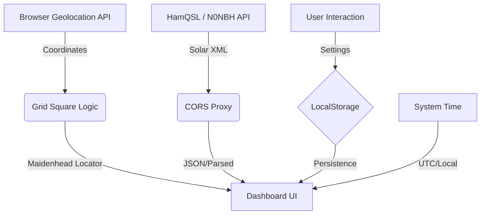

# 📡 9M2PJU Amateur Radio Contest Clock

A premium, high-visibility dashboard designed for the modern Amateur Radio operator. Featuring real-time UTC/Local clocks, live solar propagation indices, and automated Maidenhead Grid Square calculation.

---

## 🏗️ System Architecture

---

## 🚀 Key Features

### 🕒 Triple-Clock Precision
*   **Primary UTC Clock**: High-visibility digital readout using Orbitron typography, essential for log synchronization.
*   **Station Local Time**: Real-time display of the operator's current timezone.
*   **Contest Countdown**: Dynamic timer to track contest duration or specific window openings.

### ☀️ Propagation Intelligence
*   **Live Indices**: Real-time fetching of SFI (Solar Flux Index), Sunspot Number, A-Index, and K-Index.
*   **Smart Advice**: Algorithms analyze live solar conditions to suggest the best bands (e.g., Gray line openings, HF noise alerts).

### 🌍 Location Awareness
*   **Auto-Maidenhead**: Automatically calculates your 6-character Grid Square (e.g., OJ03) based on real-time GPS coordinates.
*   **Station Reference**: Instant display of latitude and longitude for precise antenna aiming.

---

## 📖 Practical Usage

### 🏆 Radio Contesting
Keep your hands on the paddles or microphone. A quick glance provides:
- Exact UTC for your logging software.
- Time remaining in the current contest window.
- Solar warnings to switch bands when conditions change.

### 🧗 Field Operations (SOTA / POTA)
Perfect for mobile and tablet views while operating portable:
- Automatic Grid Square detection without manual lookup.
- High-contrast dark mode for low-light or tent operations.
- Minimal battery overhead as a lightweight web application.

### 🏋️ Training & Exercises
Ideal for emergency communication drills:
- Unified time reference for multiple operators.
- Clear, unambiguous display for non-technical volunteers.
- Fullscreen mode for Command Center displays.

---

## 🛠️ Built With
- **React 18** & **Vite** for ultra-fast performance.
- **Lucide-React** for clean, modern iconography.
- **Date-fns** for robust time management.
- **Glassmorphism Design** for a state-of-the-art aero aesthetic.

---

> [!TIP]
> **Station Link**: [contest.hamradio.my](https://contest.hamradio.my)

Made with ❤️ by [9M2PJU](https://hamradio.my) | 73!

## Support

If you find this project useful, please consider supporting it:

